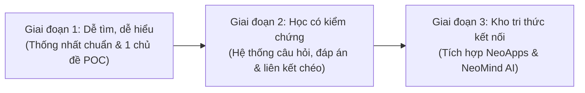

# Repo Plan — NeoKnowledge

Tài liệu kế hoạch phát triển và định hướng tổ chức kho tri thức **NeoKnowledge** thuộc hệ sinh thái NeoProject.

---

## 1. Mục tiêu và phạm vi (Scope & Objectives)

### 1.1. Mục tiêu cốt lõi
NeoKnowledge được xây dựng với vai trò là **nguồn tri thức chuẩn (single source of truth for knowledge)** của hệ sinh thái Neo, tập trung vào:
- Hệ thống hóa toàn bộ kiến thức lý thuyết, ghi chú kỹ thuật, nguyên lý và kinh nghiệm thuộc mảng Hệ thống nhúng (Embedded Systems), Cơ điện tử (Mechatronics), Vi điều khiển, RTOS, giao thức truyền thông và các lĩnh vực công nghệ liên quan.
- Xây dựng hệ thống câu hỏi, bài tự kiểm tra (conceptual, analytical, practical self-assessments) giúp người học đo lường và củng cố mức độ hiểu biết.
- Định hình các lộ trình học tập (learning paths / roadmaps) theo môn học hoặc chuyên đề, kèm theo điều kiện tiên quyết và mục tiêu cụ thể.
- Lập danh mục tài nguyên tham chiếu chuẩn (references, datasheets, application notes, sách kỹ thuật, bài nghiên cứu và liên kết tài nguyên số).

### 1.2. Phạm vi và nguyên tắc tiếp cận
- **Tập trung vào tri thức:** Chỉ lưu trữ tài liệu giải thích khái niệm, phân tích kỹ thuật, phương pháp luận, tóm tắt và câu hỏi kiểm tra.
- **Không nhân bản mã nguồn (Single source of runnable code):** Các ví dụ chạy được, dự án thực hành không lưu tại NeoKnowledge mà được liên kết trực tiếp sang `NeoPlayground`.
- **Không chứa đặc tả sản phẩm độc quyền:** Tài liệu thiết kế hệ thống, kiến trúc chi tiết của các sản phẩm ứng dụng thực tế thuộc về `NeoLab`.
- **Cơ chế cập nhật độc lập:** NeoKnowledge không phát hành theo chu kỳ release phiên bản nghiêm ngặt như phần mềm sản phẩm, mà được cập nhật liên tục (continuous updates) theo tiến độ học tập và tích lũy tri thức.

---

## 2. Hiện trạng thực tế và bằng chứng (Current State & Evidence)

Mọi ghi nhận trạng thái dưới đây được xác minh trực tiếp từ công cụ và môi trường phát triển:

### 2.1. Vị trí và thông tin kho lưu trữ
- **Worktree cha (Superproject):** `H:\Learning\Neo\NeoProject_worktrees\amber-slope`
  - Branch làm việc hiện tại: `worktree/amber-slope` (sạch, không có thay đổi dở dang).
  - Commit superproject ghi nhận: `1330f31 chore: remove local Nimbalyst calendar from version control` (trên nền commit cấu hình submodule gốc `f325059 update: Add submodules`).
  - Đường dẫn file canvas kế hoạch: `docs/NeoProject.canvas` (tài liệu canvas v2 lưu trữ trong repo cha).
- **Đường dẫn submodule NeoKnowledge:** `H:\Learning\Neo\NeoProject_worktrees\amber-slope\NeoKnowledge`
- **Nhánh làm việc trong repo con:** `docs/repo-plan` (được tạo mới từ commit `4a0749f`, độc lập và chưa sửa đổi gitlink của superproject).
- **Remote URL:** `git@github.com:NeoTech-vietnam/NeoKnowledge.git` (Giao thức SSH — xác nhận qua cấu hình `.gitmodules` sau commit `501e68b fix: update submodule URLs to use SSH instead of HTTPS`. Chi tiết này ghi đè các mô tả HTTPS ban đầu trong một số thẻ canvas cũ).

### 2.2. Kiểm tra mã nguồn và lịch sử commit
- **Commit hiện tại (Pinned Commit):** `4a0749fb7f2fb5071e08e052cd1984a8c78a4937`
  - Message: `Initial commit`
  - Trạng thái kiểm tra `git ls-files`: Chỉ chứa đúng **01 file duy nhất**: `README.md`.
- **Nội dung `README.md` hiện tại:**
  ```markdown
  # NeoKnowledge
  Curated knowledge, concise learning notes, topic questions, study roadmaps, and resource references for the Neo ecosystem. Runnable exercises and product source code live in their owning repositories.
  ```
- **Hiện trạng dữ liệu cũ:**
  - Kho lưu trữ [NeoLearning](https://github.com/NeoTech-vietnam/NeoLearning) vẫn đang đứng độc lập, **hoàn toàn chưa được chuyển giao (migrate)** sang NeoKnowledge.
  - Chưa có cấu trúc thư mục, chưa có ghi chú, chưa có liên kết Drive thực tế.

---

## 3. Cấu trúc thư mục sắp tới được đề xuất (Proposed Structure)

> [!NOTE]
> Bảng cấu trúc dưới đây là **đề xuất thiết kế** theo Canvas v2. Giai đoạn này chỉ tạo duy nhất tài liệu plan, **không tạo trước các thư mục rỗng**.

```text
NeoKnowledge/
├── docs/                      # Tài liệu nội bộ repo và quy chuẩn viết
│   ├── Repo Plan.md           # Kế hoạch phát triển tổng thể (tài liệu này)
│   └── Note-Standard.md       # (Đề xuất) Quy chuẩn cấu trúc một bài note chuẩn
├── notes/                     # (Đề xuất) Ghi chú lý thuyết và khái niệm kỹ thuật
│   ├── embedded/              # Vi điều khiển, ngoại vi, thanh ghi, kiến trúc phần cứng
│   ├── rtos/                  # Task, scheduling, queue, mutex, semaphore, sync primitives
│   ├── protocols/             # UART, SPI, I2C, CAN, BLE, Zigbee, Wi-Fi, Ethernet
│   └── mechatronics/          # Điều khiển động cơ, cảm biến, giải thuật PID, xử lý tín hiệu
├── questions/                 # (Đề xuất) Bộ câu hỏi đánh giá và tự kiểm tra
│   ├── conceptual/            # Câu hỏi giải thích khái niệm cốt lõi
│   ├── analytical/            # Câu hỏi phân tích, xử lý tình huống, so sánh kiến trúc
│   └── answers/               # Đáp án tham khảo, giải thích chi tiết và gợi ý kiểm chứng
├── learning-paths/            # (Đề xuất) Lộ trình và kế hoạch học tập
│   ├── embedded-engineer/     # Lộ trình từ nền tảng đến làm chủ vi điều khiển
│   └── control-systems/       # Lộ trình học thiết kế hệ thống điều khiển
└── references/                # (Đề xuất) Thư mục tài nguyên và chỉ mục liên kết
    ├── datasheets/            # Danh mục datasheet, link tra cứu và ghi chú quan trọng
    ├── drive-links/           # Chỉ mục liên kết tài nguyên dung lượng lớn trên Google Drive
    └── bibliography/          # Sách tham khảo, giáo trình đại học, bài báo khoa học
```

### 3.1. Phân định trách nhiệm và chuẩn định dạng
1. **Thư mục `notes/`:**
   - **Trách nhiệm:** Lưu trữ tri thức cốt lõi theo mô hình ghi chú ngắn gọn: *Điều hiểu được — Ví dụ phân tích — Nguồn tham khảo — Câu hỏi đào sâu*.
   - **Quy chuẩn nguồn:** Mỗi ghi chú phải dẫn chứng nguồn rõ ràng (tên sách, chương, datasheet/reference manual số hiệu trang, hoặc tài liệu đào tạo chính thức).
2. **Thư mục `questions/`:**
   - **Trách nhiệm:** Cung cấp bộ công cụ tự kiểm tra hiểu biết. Tách biệt rõ ràng giữa câu hỏi và đáp án để thúc đẩy tư duy phản biện.
3. **Thư mục `learning-paths/`:**
   - **Trách nhiệm:** Định hướng thứ tự học, mối quan hệ tiên quyết giữa các chủ đề (prerequisites), gắn liền với bài tập cụ thể.
4. **Thư mục `references/`:**
   - **Trách nhiệm:** Quản lý siêu dữ liệu (metadata), mục lục và liên kết đến các file dung lượng lớn, tài liệu bên ngoài.

---

## 4. Lộ trình phát triển qua các giai đoạn (Roadmap)

Kế hoạch phát triển NeoKnowledge chia làm 3 giai đoạn theo định hướng của kiến trúc Canvas:



### 4.1. Giai đoạn đầu: Dễ tìm, dễ hiểu (Early Phase)
- **Mục tiêu:** Thiết lập khung chuẩn hóa ghi chú, khảo sát dữ liệu `NeoLearning` cũ và thử nghiệm trên 01 chủ đề đại diện.
- **Nội dung công việc:**
  1. Thống nhất quy chuẩn định dạng cho một bài ghi chú kỹ thuật (Cấu trúc mẫu: Tóm tắt lý thuyết, hình minh họa, ví dụ tình huống, đường dẫn tới mã mẫu ở NeoPlayground, nguồn trích dẫn).
  2. Khảo sát cấu trúc bài học hiện có trong `NeoLearning`, phân loại các bài còn giá trị và lập danh mục bài học cần chuyển giao.
  3. Chọn 01 chủ đề cơ bản (ví dụ: *Embedded GPIO & Interrupt Handling*) để hoàn thiện trọn vẹn từ note, câu hỏi tự kiểm tra đến danh mục tham chiếu.
- **Đầu ra (Deliverables):**
  - Tài liệu quy chuẩn ghi chú (`docs/Note-Standard.md`).
  - 01 chủ đề mẫu hoàn chỉnh thể hiện đúng quan hệ giữa ghi chú và liên kết mã nguồn.
  - Danh mục ánh xạ nội dung từ `NeoLearning` sang `NeoKnowledge`.
- **Tiêu chí hoàn thành (Done Criteria):**
  - Người đọc từ một chủ đề bất kỳ có thể tra cứu nhanh: khái niệm cần nắm, câu hỏi liên quan, tài liệu tham khảo và đường dẫn sang bài tập thực hành tương ứng.

### 4.2. Giai đoạn mở rộng: Học có kiểm chứng (Expansion Phase)
- **Mục tiêu:** Mở rộng ra các chuyên đề cốt lõi của Hệ thống nhúng và Cơ điện tử; xây dựng cơ chế tự kiểm chứng kiến thức.
- **Nội dung công việc:**
  1. Phân loại câu hỏi thành 3 nhóm rõ rệt: Khái niệm (Conceptual), Phân tích (Analytical), Thực hành (Practical).
  2. Bổ sung mục lời giải / gợi ý kiểm chứng độc lập (`questions/answers/`).
  3. Xây dựng sơ đồ cây kiến thức tiên quyết (Prerequisites graph) trong các lộ trình học tập (`learning-paths/`).
  4. Đồng bộ 2 chiều với các ví dụ thực tế đã được kiểm nghiệm bên `NeoPlayground` và các ứng dụng tích hợp bên `NeoLab`.
- **Đầu ra (Deliverables):**
  - Bộ ghi chú đầy đủ cho các module vi điều khiển thông dụng (UART, SPI, I2C, Timer, ADC, DMA, FreeRTOS).
  - Ngân hàng câu hỏi tự đánh giá kèm giải thích kỹ thuật chi tiết.
- **Tiêu chí hoàn thành (Done Criteria):**
  - Mỗi chuyên đề đều có lộ trình học rõ ràng và có phương pháp kiểm chứng kiến thức (bằng câu hỏi lý thuyết hoặc thực nghiệm tại Playground).

### 4.3. Giai đoạn dài hạn: Kho kiến thức kết nối (Long-term Phase)
- **Mục tiêu:** Biến NeoKnowledge thành kho dữ liệu có cấu trúc phục vụ các ứng dụng tự động trong hệ sinh thái.
- **Nội dung công việc:**
  1. Định danh ổn định (Stable IDs / Anchors) cho các khái niệm và câu hỏi khi có nhu cầu đồng bộ dữ liệu.
  2. Hỗ trợ `NeoApps` (Web/Desktop/Mobile) đọc trực tiếp nội dung để cung cấp giao diện học tập, flashcard ôn tập và theo dõi tiến độ học.
  3. Cập nhật phản hồi liên tục từ thực nghiệm phần cứng của `NeoLab` về lý thuyết trong `NeoKnowledge`.
  4. *(Tùy chọn nâng cao)*: Tích hợp với công cụ trợ lý AI từ `NeoMind` để truy xuất tri thức (RAG - Retrieval Augmented Generation) sau khi kho tài liệu đạt độ hoàn thiện cao.
- **Đầu ra (Deliverables):**
  - Hệ thống dữ liệu Markdown có siêu dữ liệu chuẩn hóa, sẵn sàng cho API / NeoApps phân tích cú pháp.
- **Tiêu chí hoàn thành (Done Criteria):**
  - NeoApps hiển thị và tìm kiếm được nội dung từ NeoKnowledge mà không bị gãy liên kết khi cấu trúc tệp thay đổi.

---

## 5. Phụ thuộc và ranh giới với các repo khác (Dependencies & Boundaries)

| Repo liên kết | Vai trò & Ranh giới trách nhiệm | Quan hệ trao đổi | Trạng thái hiện tại |
| :--- | :--- | :--- | :--- |
| **NeoPlayground** | Lưu trữ mã thực hành, ví dụ mẫu chạy được trên phần cứng/bộ mô phỏng. Không lưu lý thuyết dông dài. | `NeoKnowledge` đặt liên kết dẫn tới ví dụ trong `NeoPlayground`. Kết quả đo đạc thực tế từ Playground quay lại cập nhật ghi chú. | Độc lập, chỉ có README |
| **NeoLab** | Lưu trữ mã nguồn sản phẩm, tài liệu kiến trúc hệ thống và hồ sơ kiểm thử sản phẩm thực tế. | `NeoLab` tham chiếu các nguyên lý nền tảng từ `NeoKnowledge`. NeoKnowledge bổ sung kinh nghiệm thiết kế rút ra từ sản phẩm. | Độc lập, chỉ có README |
| **NeoApps** | Ứng dụng giao diện người dùng, công cụ hỗ trợ học tập, hiển thị tri thức. | `NeoKnowledge` cung cấp nội dung; `NeoApps` đọc và hiển thị cho người học. | Độc lập, chỉ có README |
| **NeoMind** | Quy trình làm việc, skill, adapter và agent tự động hóa. | `NeoMind` cung cấp quy trình biên soạn / soát lỗi kiến thức hoặc hỗ trợ tra cứu AI sau này. | Độc lập, chỉ có README |
| **NeoLearning** *(Cũ)* | Kho lưu trữ học liệu ban đầu. | Nguồn để chọn lọc chuyển giao (migration) sang NeoKnowledge. | Repo cũ, chưa migrate |
| **NeoProject** | Superproject quản lý commit stable. | Khóa commit của NeoKnowledge khi cần thiết lập mốc tích hợp chung. Không can thiệp nhánh làm việc hằng ngày. | Superproject đã cấu hình submodule |

---

## 6. Quyết định còn mở và bước tiếp theo (Open Decisions & Next Steps)

### 6.1. Bảng phân loại trạng thái các quyết định
- **ĐÃ CHỐT (Agreed):**
  - NeoKnowledge là một submodule trực tiếp cấp 1 trong NeoProject, quản lý độc lập tại nhánh `main`.
  - Làm việc hằng ngày diễn ra trong nhánh làm việc riêng của `NeoKnowledge`, không tự động update commit lên `NeoProject`.
  - Không nhân bản mã nguồn chạy được vào NeoKnowledge (mã thuộc về `NeoPlayground`).
  - Repo không áp đặt cơ chế release cứng nhắc theo phiên bản, cho phép commit liên tục khi có bài mới.
- **ĐÃ CÓ (Existing):**
  - Repo GitHub: `https://github.com/NeoTech-vietnam/NeoKnowledge` (kèm remote SSH `git@github.com:NeoTech-vietnam/NeoKnowledge.git`).
  - Commit khởi tạo: `4a0749f` chỉ gồm `README.md`.
  - Repo cũ `NeoLearning` chứa nhiều tài liệu bài học ban đầu.
- **ĐỀ XUẤT (Proposed) & ĐIỂM CÒN MỞ (Open Decisions):**
  1. **Chính sách lưu trữ Google Drive:** Có sử dụng Google Drive làm nơi lưu trữ chính thức cho các tệp PDF sách, video bài giảng, datasheet lớn và chỉ lưu liên kết URL trong file Markdown hay không? Hay có giải pháp lưu trữ tài nguyên số khác?
  2. **Kế hoạch chuyển giao từ `NeoLearning`:** Xác định danh mục cụ thể các bài học trong `NeoLearning` cần chuyển giao sang `NeoKnowledge`, các bài cần viết lại hoàn toàn, và thời điểm lưu trữ (archive) repo `NeoLearning`.
  3. **Quy chuẩn Metadata / Frontmatter:** Có nên áp dụng chuẩn `YAML frontmatter` (chứa các trường: `title`, `tags`, `prerequisites`, `status`, `updated_at`) ngay từ bài ghi chú đầu tiên để phục vụ cho NeoApps và công cụ AI tra cứu sau này hay không?
  4. **Phương thức liên kết chéo (Cross-repo linking):** Khi dẫn link sang `NeoPlayground`, nên dùng URL tuyệt đối trên GitHub (gắn với tag/commit cố định), hay quy ước mã bài thực hành (Identifier)?

### 6.2. Các bước triển khai tiếp theo
1. **Bước 1 — Xem xét và phê duyệt Plan:** Phản hồi và chốt các điểm còn mở với chủ dự án.
2. **Bước 2 — Ban hành chuẩn ghi chú (`docs/Note-Standard.md`):** Quy định rõ mẫu trình bày Markdown, cấu trúc thư mục con và quy tắc đặt tên tệp.
3. **Bước 3 — Triển khai bài mẫu (Proof of Concept):** Soạn thảo hoàn chỉnh 01 chủ đề tiêu biểu (bao gồm note, câu hỏi, đáp án, tài liệu tham khảo và liên kết tới mã nguồn bên `NeoPlayground`) để nghiệm thu quy trình trước khi mở rộng toàn diện.
